<a href="https://yarohn.me"><picture><source media="(prefers-color-scheme: dark)" srcset="assets/card-4957f726/0-head-dark.svg"></picture></a><picture><source media="(prefers-color-scheme: dark)" srcset="assets/card-4957f726/1-now-dark.svg"></picture><a href="https://focus-ai.io"><picture><source media="(prefers-color-scheme: dark)" srcset="assets/card-4957f726/2-role-dark.svg"></picture></a><picture><source media="(prefers-color-scheme: dark)" srcset="assets/card-4957f726/3-studying-dark.svg"></picture><a href="https://yarohn.me/#work"><picture><source media="(prefers-color-scheme: dark)" srcset="assets/card-4957f726/4-built-dark.svg"></picture></a><a href="https://yarohn.me/#work"><picture><source media="(prefers-color-scheme: dark)" srcset="assets/card-4957f726/5-runs-dark.svg"></picture></a><picture><source media="(prefers-color-scheme: dark)" srcset="assets/card-4957f726/6-speaks-dark.svg"></picture><picture><source media="(prefers-color-scheme: dark)" srcset="assets/card-4957f726/7-foot-dark.svg"></picture>

[yarohn.me](https://yarohn.me) · [X](https://x.com/yaro_hn) · [LinkedIn](https://www.linkedin.com/in/yaroslavhnoianyi) · [Instagram](https://www.instagram.com/yaro_hn/)
